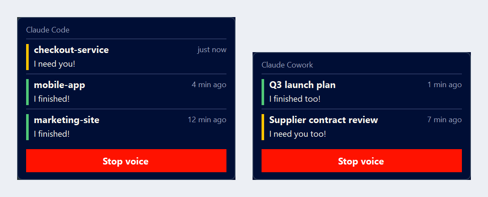

# Finished Too

**claude-voice-alerts**: voice and on-screen alerts for Claude Code and Claude Cowork on Windows. Hear when a task finishes or needs you, see which project it was, and walk away from your desk.

[Română](README.ro.md)



## What it does

- **Claude Code**: when a session finishes, asks for a permission, asks you a question or waits for plan approval, a voice says so and a window lists the project (the folder you work in). Each terminal has its own row, so 3 to 6 sessions in parallel never overwrite each other.
- **Claude Cowork**: a small watcher reads the conversation list of the Claude desktop app. When a conversation finishes or waits for you, a second voice answers, and a second window lists the conversation title.
- The voice repeats every few seconds, up to 5 minutes. Then it goes quiet, but the window stays until you click it.
- Two alerts at once: the voices take turns, they never talk over each other.
- Click a row: that alert closes and its window comes to front (the terminal or editor of that session, or the Claude app with that conversation open).
- 7 languages, any combination of male and female voices, your own messages.

## Requirements

- Windows 10 or 11 (macOS and Linux are not supported yet)
- Claude Code, for the Claude Code alerts
- The Claude desktop app, for the Cowork alerts
- Internet during install (the voices are generated with edge-tts). Python is installed with winget if missing.

## Install

**With Claude Code**, say: `Install the voice alerts from https://github.com/dragoslavflorin-ux/claude-voice-alerts`

**With PowerShell:**

```powershell
git clone https://github.com/dragoslavflorin-ux/claude-voice-alerts.git "$env:USERPROFILE\claude-voice-alerts"
cd "$env:USERPROFILE\claude-voice-alerts"
powershell -ExecutionPolicy Bypass -File .\install.ps1
```

The installer asks 5 questions, then plays each voice once so you hear what you picked:

| # | Question | Choices | Parameter |
|---|---|---|---|
| 1 | Language | Română, English, Español, Português (Brasil), Français, Deutsch, Italiano, Other (any edge-tts voice, your own texts) | `-Language ro\|en\|es\|pt\|fr\|de\|it\|other` |
| 2 | Tone | Playful (default) or Neutral (office) | `-Tone playful\|neutral` |
| 3 | Voices | Male or female for Claude Code, then for Cowork, any combination; or an exact voice name | `-CodeVoice male\|female\|<name>` `-CoworkVoice ...` |
| 4 | Messages | Keep the presets or write any of the 4 | `-CodeDone` `-CodeNeedsYou` `-CoworkDone` `-CoworkNeedsYou` |
| 5 | What to install | Both, only Claude Code, only Cowork | `-Parts both\|code\|cowork` |

Add `-Yes` to install without questions. Running the installer again uses your previous answers as defaults.
More options: `-Hotkey Ctrl+Alt+M`, `-CodeMonitor leftmost`, `-CoworkMonitor app`, `-CodeCorner bottom-left`, `-CoworkCorner bottom-right`.

It installs into `%USERPROFILE%\.claude\hooks\claude-voice-alerts\`, adds its hooks to `~/.claude/settings.json` (after a backup, without touching your other settings), adds a Claude Code skill, a Start menu shortcut with the stop hotkey and the Cowork watcher at logon. At the end it checks itself and prints what, if anything, you need to do by hand.

## Customize

Edit `%USERPROFILE%\.claude\hooks\claude-voice-alerts\config.json`, or run the installer again with new answers.

| Setting | Default | Meaning |
|---|---|---|
| `repeat_pause_seconds` | 5 | pause between repeats of a voice |
| `voice_limit_seconds` | 300 | the voice stops after this |
| `keep_window_after_timeout` | true | the window stays after the voice stops |
| `min_task_seconds` | 0 | no alert for tasks shorter than this |
| `cowork_idle_seconds` | 20 | Cowork alerts even when the Claude app is in front, if you have not touched keyboard or mouse for this long |
| `code.monitor`, `cowork.monitor` | leftmost, app | `primary`, `leftmost`, `rightmost`, or `app` (the monitor of the session window or of the Claude app) |
| `code.corner`, `cowork.corner` | bottom-left, bottom-right | `bottom-left`, `bottom-right`, `top-left`, `top-right` |
| `margin_px` | 16 | distance from the screen edge (scaled with the monitor DPI) |
| `max_rows` | 5 | rows per window, then "+N more" |

Messages, voices, language and hotkey are changed with the installer, because the voices must be generated again.

## Stop, update, uninstall, diagnose

- **Stop an alert**: click its row, click the red button (all rows of that window), or press **Ctrl+Alt+M** (everything). Claude Code alerts also stop when you send a new message in that session; Cowork alerts stop when you use the Claude app or when the conversation changes state (read, approved, restarted), even from your phone.
- **Update**: `git pull`, then run `install.ps1` again.
- **Uninstall**: `powershell -ExecutionPolicy Bypass -File .\uninstall.ps1` removes exactly what the installer added.
- **Diagnose**: `powershell -ExecutionPolicy Bypass -File .\doctor.ps1` explains in plain words what does not work and what to do. In Claude Code you can also ask: "the alert did not sound, check claude-voice-alerts".

## Limitations

- **Known issue in v2.0.0**: the Cowork watcher uses more memory the longer it runs (about 100 MB per hour; it starts at logon). Fixed in v2.0.1. Until then, restart it once a day: sign out and back in, or restart Windows. If you do not use Cowork, run `install.ps1 -Parts code` and the watcher is not installed.
- Windows only for now. All Windows code lives in `platform/windows`, so a macOS port can be added later.
- Cowork detection needs the Claude desktop app open (its window can stay behind others, but not closed to the tray) with the conversation list visible. It works with every language of the Claude app (labels are read from the app itself at install). Only the conversations listed in the sidebar (the most recent ones) are watched.
- If the Claude app is the active window and you used it in the last 20 seconds, Cowork does not speak: you are already looking at it.
- Clicking a Claude Code row brings the right terminal or editor window to front when it can be identified (Windows Terminal, console, VS Code and its forks); a specific tab inside it cannot be selected.
- Hooks run through Git Bash when it is installed (about 40 ms per tool call, the cost of starting bash). Without Git Bash they run in PowerShell, about 0.2 s per tool call.

## About the default messages

In Romanian, English and Spanish the playful set has an obvious double meaning. In the other languages it is more subtle. The neutral set is one choice away.

## Why this exists

I run several projects in parallel. My left monitor runs Claude Code, with three to six terminals open. My right monitor runs the Claude desktop app, with three to six Cowork conversations, one per project. Cowork is the brain: it helps me think, plan and decide. Claude Code is the executor: it builds what we decided. I dictate most of my prompts by voice, so the work goes out fast.

Then the tasks got long. One hour, two, sometimes four. And the windows started blurring together. Which terminal finished? Which conversation is waiting for my approval? Which one is still working? I caught myself glued to the screens, jumping from window to window, stressed that something had been waiting for me for half an hour while I was staring at the wrong one.

What I wanted was simple: hand out the work, get up from the desk, make a coffee, and have the machine call me when it is done.

Now it does. When a Claude Code task finishes, a voice on the left says so. When Cowork finishes, a second voice on the right answers: me too. I hear it from across the room, walk back, handle it, and leave again with a clear head.

In Romanian, the default lines are "M-am terminat!" and "Și eu m-am terminat!" ("I finished!" and "I finished too!"). They carry a cheeky double meaning that every Romanian gets instantly. That is intentional. My team loved it, which is exactly why this is now public. Other languages get the closest equivalent we could find, and a neutral, office-safe set is one choice away.

Florin Dragoslav, broker owner of REMAX Champions, Brașov, Romania

## License

MIT
