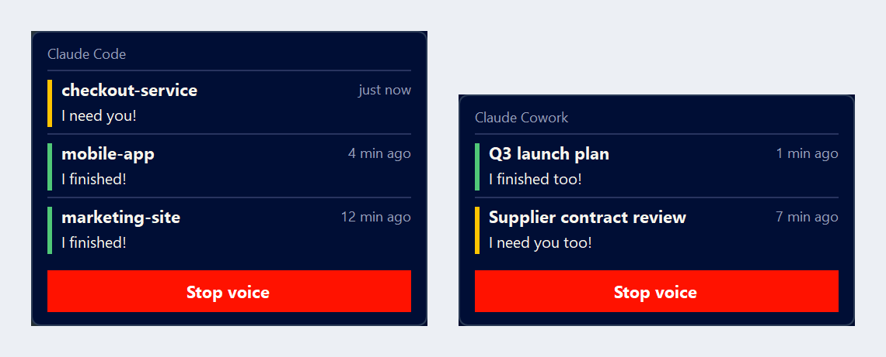

# Finished Too

**claude-voice-alerts**: alerte vocale și pe ecran pentru Claude Code și Claude Cowork, pe Windows. Auzi când o sarcină s-a terminat sau are nevoie de tine, vezi la ce proiect, și poți pleca de la birou.

[English](README.md)



## Ce face

- **Claude Code**: când o sesiune termină, cere o permisiune, îți pune o întrebare sau așteaptă aprobarea planului, o voce îți spune, iar o fereastră arată proiectul (folderul în care lucrezi). Fiecare terminal are rândul lui, deci 3-6 sesiuni în paralel nu se mai calcă pe picioare.
- **Claude Cowork**: un watcher mic citește lista de conversații din aplicația desktop Claude. Când o conversație termină sau te așteaptă, îți răspunde o a doua voce, iar o a doua fereastră arată titlul conversației.
- Vocea se repetă la câteva secunde, cel mult 5 minute. Apoi tace, dar fereastra rămâne până dai click.
- Două alerte deodată: vocile vorbesc pe rând, niciodată una peste alta.
- Click pe un rând: alerta se închide și vine în față fereastra ei (terminalul sau editorul sesiunii, ori aplicația Claude cu conversația deschisă).
- 7 limbi, orice combinație de voce de bărbat și de femeie, mesajele tale.

## Cerințe

- Windows 10 sau 11 (macOS și Linux nu sunt suportate deocamdată)
- Claude Code, pentru alertele Claude Code
- Aplicația desktop Claude, pentru alertele Cowork
- Internet la instalare (vocile se generează cu edge-tts). Python se instalează prin winget dacă lipsește.

## Instalare

**Cu Claude Code**, spune: `Instalează alertele vocale din https://github.com/dragoslavflorin-ux/claude-voice-alerts`

**Cu PowerShell:**

```powershell
git clone https://github.com/dragoslavflorin-ux/claude-voice-alerts.git "$env:USERPROFILE\claude-voice-alerts"
cd "$env:USERPROFILE\claude-voice-alerts"
powershell -ExecutionPolicy Bypass -File .\install.ps1
```

Instalatorul pune 5 întrebări, apoi redă o dată fiecare voce, ca să auzi ce ai ales:

| # | Întrebare | Variante | Parametru |
|---|---|---|---|
| 1 | Limba | Română, English, Español, Português (Brasil), Français, Deutsch, Italiano, Other (orice voce edge-tts, texte scrise de tine) | `-Language ro\|en\|es\|pt\|fr\|de\|it\|other` |
| 2 | Tonul | Jucăuș (implicit) sau Neutru (pentru birou) | `-Tone playful\|neutral` |
| 3 | Vocile | Bărbat sau femeie pentru Claude Code, apoi pentru Cowork, orice combinație; sau numele exact al vocii | `-CodeVoice male\|female\|<nume>` `-CoworkVoice ...` |
| 4 | Mesajele | Păstrezi presetul sau scrii oricare dintre cele 4 | `-CodeDone` `-CodeNeedsYou` `-CoworkDone` `-CoworkNeedsYou` |
| 5 | Ce se instalează | Ambele, doar Claude Code, doar Cowork | `-Parts both\|code\|cowork` |

Cu `-Yes` instalează fără întrebări. La o nouă rulare, răspunsurile anterioare devin valorile implicite.
Alte opțiuni: `-Hotkey Ctrl+Alt+M`, `-CodeMonitor leftmost`, `-CoworkMonitor app`, `-CodeCorner bottom-left`, `-CoworkCorner bottom-right`.

Se instalează în `%USERPROFILE%\.claude\hooks\claude-voice-alerts\`. Adaugă hook-urile în `~/.claude/settings.json` (după backup, fără să atingă alte setări), un skill pentru Claude Code, o scurtătură în meniul Start cu tasta de oprire și watcher-ul Cowork la pornirea Windows. La final se verifică singur și îți spune ce ai de făcut manual, dacă e cazul.

## Personalizare

Modifici `%USERPROFILE%\.claude\hooks\claude-voice-alerts\config.json` sau rulezi din nou instalatorul cu alte răspunsuri.

| Setare | Implicit | Ce face |
|---|---|---|
| `repeat_pause_seconds` | 5 | pauza dintre repetările vocii |
| `voice_limit_seconds` | 300 | după cât timp tace vocea |
| `keep_window_after_timeout` | true | fereastra rămâne după ce tace vocea |
| `min_task_seconds` | 0 | fără alertă pentru sarcini mai scurte de atât |
| `cowork_idle_seconds` | 20 | Cowork sună și când aplicația Claude e în față, dacă n-ai atins tastatura sau mouse-ul de atâtea secunde |
| `code.monitor`, `cowork.monitor` | leftmost, app | `primary`, `leftmost`, `rightmost` sau `app` (monitorul ferestrei sesiunii sau al aplicației Claude) |
| `code.corner`, `cowork.corner` | bottom-left, bottom-right | `bottom-left`, `bottom-right`, `top-left`, `top-right` |
| `margin_px` | 16 | distanța față de marginea ecranului (scalată cu DPI-ul monitorului) |
| `max_rows` | 5 | rânduri pe fereastră, apoi "încă N" |

Mesajele, vocile, limba și tasta se schimbă din instalator, pentru că vocile trebuie generate din nou.

## Oprire, actualizare, dezinstalare, diagnostic

- **Oprești o alertă**: click pe rândul ei, click pe butonul roșu (toate rândurile ferestrei) sau **Ctrl+Alt+M** (tot). Alertele Claude Code se opresc și când trimiți un mesaj nou în sesiunea aceea; alertele Cowork se opresc când folosești aplicația Claude sau când conversația își schimbă starea (citită, aprobată, repornită), chiar și de pe telefon.
- **Actualizare**: `git pull`, apoi rulezi din nou `install.ps1`.
- **Dezinstalare**: `powershell -ExecutionPolicy Bypass -File .\uninstall.ps1` scoate exact ce a pus instalatorul.
- **Diagnostic**: `powershell -ExecutionPolicy Bypass -File .\doctor.ps1` îți spune pe înțeles ce nu merge și ce ai de făcut. În Claude Code poți cere și: "alerta n-a sunat, verifică claude-voice-alerts".

## Limitări

- Deocamdată doar Windows. Tot codul pentru Windows stă în `platform/windows`, ca un port pe macOS să poată fi adăugat mai târziu.
- Detecția Cowork are nevoie de aplicația desktop Claude deschisă (fereastra poate sta în spatele altora, dar nu închisă în tray), cu lista de conversații vizibilă. Merge cu orice limbă a aplicației Claude (etichetele se citesc din aplicație la instalare). Sunt urmărite doar conversațiile din bara laterală (cele mai recente).
- Dacă aplicația Claude e fereastra activă și ai folosit-o în ultimele 20 de secunde, Cowork nu vorbește: te uiți deja la ea.
- Click pe un rând Claude Code aduce în față terminalul sau editorul potrivit, când poate fi identificat (Windows Terminal, consolă, VS Code și variantele lui); un anumit tab din interior nu poate fi selectat.
- Hook-urile rulează prin Git Bash când e instalat (cam 40 ms la fiecare unealtă folosită, costul pornirii bash). Fără Git Bash rulează în PowerShell, cam 0,2 s la fiecare unealtă.

## Despre mesajele implicite

În română, engleză și spaniolă, varianta jucăușă are un dublu sens evident. În celelalte limbi e mai subtil. Varianta neutră e la o alegere distanță.

## De ce există

Lucrez la mai multe proiecte în paralel. Pe monitorul din stânga rulează Claude Code, cu trei până la șase terminale deschise. Pe monitorul din dreapta rulează aplicația desktop Claude, cu trei până la șase conversații Cowork, câte una pe proiect. Cowork e creierul: mă ajută să gândesc, să planific și să decid. Claude Code e executantul: construiește ce am hotărât. Cele mai multe prompturi le dictez, așa că munca pleacă repede.

Apoi sarcinile s-au lungit. O oră, două, uneori patru. Și ferestrele au început să se amestece. Care terminal a terminat? Care conversație așteaptă aprobarea mea? Care încă lucrează? M-am trezit lipit de ecrane, sărind din fereastră în fereastră, stresat că ceva mă aștepta de o jumătate de oră în timp ce eu mă uitam la cea greșită.

Ce voiam era simplu: să împart munca, să mă ridic de la birou, să-mi fac o cafea și să mă cheme mașina când e gata.

Acum o face. Când se termină o sarcină în Claude Code, o voce din stânga îmi spune. Când termină Cowork, o a doua voce din dreapta răspunde: și eu. O aud din celălalt capăt al camerei, mă întorc, rezolv și plec din nou, cu mintea limpede.

În română, replicile implicite sunt "M-am terminat!" și "Și eu m-am terminat!". Au un dublu sens obraznic, pe care orice român îl prinde pe loc. E intenționat. Echipei mele i-a plăcut, și exact de asta e acum public. Celelalte limbi primesc cel mai apropiat echivalent pe care l-am găsit, iar un set neutru, potrivit pentru birou, e la o alegere distanță.

Florin Dragoslav, broker owner REMAX Champions, Brașov, România

## Licență

MIT
